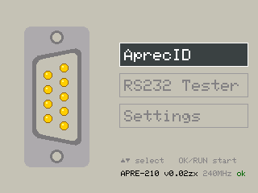

# AprecID, RS232 tester and logger for the FNIRSI DST-210

I wrote an alternative firmware that turns the FNIRSI DST-210 (oscilloscope, multimeter and
signal generator in one) into a pocket line identifier, an RS232/TTL serial tester and a logger
of current and voltage. It also plays a game.

> **Use at your own risk.** APRE-210 is an alternative firmware, a hobby project not affiliated
> with or endorsed by FNIRSI. It comes with no warranty of any kind, and I accept no liability for
> any damage to your unit, to what you connect it to, or for anything that follows from its
> readings.

Touch a wire with the probe and **AprecID** tells what it is: GND, a supply rail, an RS232 or TTL
serial line with its speed and frame, Modbus RTU, RS485, CAN, I2C, LIN, PWM. A serial line is read
**directly through the oscilloscope input**, without a USART or a MAX3232. The **RS232 Tester**
then shows the waveform with the characters under the bits they were read from, the line's
electrical health, and the data in hex and ASCII. The **Logger** draws the multimeter's reading
(V, mA or A) and the DC voltage on the scope input side by side, for a minute: the current an
actuator takes while it moves, and its voltage at the same time.

APRE-210 runs **next to the FNIRSI firmware**, which stays as it is. Held at power-on, RUN starts
APRE-210. Without it, the unit starts the FNIRSI firmware as before.



The same as a video: [`docs/demo.mp4`](docs/demo.mp4).

> **Note:** this is [APRE-510](https://github.com/zeromem0/apre-510) for the DSO-510 on the
> DST-210's board, which [dst210-tester232u](https://github.com/zeromem0/dst210-tester232u) first
> worked out. Its beginnings go back to David's
> [dso152-breakout](https://github.com/davidgiven/dso152-breakout).

## Is it safe?

- **The official firmware stays.** APRE-210 is added next to it; the unit starts the FNIRSI
  firmware as before, and APRE-210 only when RUN is held at power-on.
- **The FNIRSI bootloader is never touched**, neither by the update file nor by APRE-210, and the
  update itself is FNIRSI's own (MODE held at power-on). So the unit can always be put back: the
  same steps with the original FNIRSI file.
- **The calibration is never touched**: neither the scope's settings page nor the multimeter
  chip's. APRE-210 only reads the scope's calibration, and sends the multimeter only the knob
  functions the FNIRSI firmware sends.
- **What it has been tried on:** FNIRSI application V0.1.0, on a unit with board `DST_210_V1.1`
  and 1 MB of flash, updated with new versions many times over. Check your FNIRSI version first:
  if it is newer than V0.1.0, do not put an update file made from V0.1.0 on it. Keep the original
  FNIRSI `.zip`: it is the way back.
- **It is not a calibrated instrument.** AprecID, the Logger and the scope's DC voltmeter are for
  finding your way, not for measurements that matter: check those with a calibrated meter. The
  input limits of the DST-210 stay as FNIRSI gives them.

## What it does

- **AprecID** (first in the menu): what is on the probe.
  - Steady levels: GND, 3.3V, 5V, 12V, 24V, RS232 at rest.
  - Serial lines: RS232 or TTL, at the standard speeds from 1200 to 115200 baud (9600 tried
    first), the frame (7 or 8 data bits, parity, stop bits), how many frames fitted, and the text
    read. MODE shows the last five characters in boxes (CR and LF in green), the waveform, or the
    last messages a line each, with the time between them.
  - An RS232 line at rest is waited on for up to a minute, so a device that sends a message only
    now and then is still read.
  - Modbus RTU, RS485 (A and B wires), CAN (H and L), I2C (SCL), LIN, PWM, each with details on
    AUTO.
  - **Hands-off** (Settings): the line is watched and recognised again when it changes, with a
    beep at each result.
- **RS232 Tester:**
  - RS232 or TTL levels; 9600 or 19200, or speed and frame worked out from the line up to 115200
    baud, and then locked if wanted (`L`).
  - Views: protocol (the waveform with the decoded characters under it), single character (one
    frame bit by bit), bus health (levels, bit rate, rise and fall, jitter against the EIA-232
    limits), large, hex, characters (a line for each message, with the time since the one before).
  - **SNAP** waits for the first start bit and keeps the message.
- **Logger:** two channels over 60 seconds.
  - The **multimeter**, as its own display shows it: the knob on V (4 decimals, mV included), on
    mA or on A (the chip ranges by itself between µA, mA and A).
  - The **scope input as a DC voltmeter**: DC coupling, the mean of 20 ms blocks (one period of
    50 Hz mains, so the hum averages out), five readings a second, the range picked by itself from
    ±2.5 V to ±50 V.
  - Two views (AUTO): a **60 s recording** started with RUN, and **live**, the last 60 s sliding
    to the left with the newest reading at the right edge, scaled to what it shows.
  - Four layouts (▼ ▲): the two graphs one over the other, both traces in one graph (the scope's
    scale on the right), the multimeter alone, the scope alone. Each with its big value, min, max
    and mean.
  - The multimeter is isolated, so it can sit in series with a load while the probe measures the
    voltage across it.
- **Wave Raid**, a game: a ship flies over a land that is a signal going by (DC, sine, pulse
  trains, UART frames, noise, triangle, ringing, PWM), named on the top bar as a scope would name
  it. Bomb the chips and aerials on the signal, shoot the glitches that fly, or let the autopilot
  fly. As played by its autopilot: [`docs/waveraid.mp4`](docs/waveraid.mp4) (rendered on a PC from
  a step-by-step port of the game: the same land, pilot and colours as on the unit).
- **Settings**, kept in flash: colour theme, auto off (off, 10 or 30 minutes), hands-off, what it
  starts on (AprecID, the menu, a demo on made-up lines, the Logger, or the game), and erasing the
  tester's buffer.
- **USB:** the instrument's own USB socket is a serial port (USB CDC). The results go to the
  [apre page](https://zeromem0.github.io/apre/) in a browser, or to the apre Android app. Over the
  same port a PC can take a picture of the screen (`screen`) and press the buttons (`key`).

Zero volts on each range comes from the unit's own FNIRSI calibration. APRE-210 reads it from flash
and never writes there, except its own settings page at the very end of the flash. Of the commands
the multimeter chip understands, APRE-210 sends only the functions the FNIRSI firmware sends for
the knob, never anything that touches the chip's calibration.

## Connecting

- **Probe tip** on the line (TX or RX), **probe ground** on its signal ground. Probe switch on
  ×1.
- AprecID and the Logger choose the range themselves. In the tester, R8 (5 V a division) suits
  RS232 levels and R5–R6 suit TTL; ◄ ► change it.
- For the Logger, the multimeter's leads as for the FNIRSI firmware: across for V, in series for
  mA and A.

## Buttons

OK is ENTER on the case.

| Button | Press | What it does |
|---|---|---|
| RUN + POWER | at power-on | Starts APRE-210. POWER alone starts the FNIRSI firmware. |
| POWER | held 2 s | Switches the unit off, from anywhere in APRE-210 |
| OK | held | Back to the menu, from AprecID, the tester and the Logger |
| ▲ ▼, OK or RUN | short | Menu: AprecID, RS232 Tester, Logger, Wave Raid, Settings |
| AUTO | held | Menu: About |

In **AprecID**: RUN looks again; MODE goes through the characters in boxes, the waveform and the
messages a line each; AUTO shows the details, where there are any; ▼ opens bus health; OK opens
the tester, on the line just found.

In the **RS232 Tester**:

| Button | Press | What it does |
|---|---|---|
| RUN | short | `RUN` → `HOLD` → capture (`WAIT`, then `SNAP`, then `WAIT` again by itself); in `WAIT`, back to `RUN` |
| MODE | short | View: protocol → single character → bus health → large → hex → characters; opened from AprecID, after the last view back to AprecID |
| MODE | held | In `WAIT` only: a simulated message, received as if from the line |
| ◄ ► | short | Range down / up |
| ▲ ▼ | short | Sample rate up / down: 100 k, 250 k, 500 k, 1.25 M, 2 M samples/s |
| AUTO | short | Speed: 9600 → 19200 → worked out from the line (`A` in the bar) → locked on what `A` found (`L`) |
| OK | short | RS232 ↔ TTL |
| POWER | short | Learn the speed and the frame again |

In the **Logger**: RUN starts a recording (live: holds the graph); AUTO changes between the
recording and live; ▼ ▲ change the layout; MODE back to the menu.

In **Wave Raid**: the arrows fly; RUN fires (held, again and again); OK drops a bomb; AUTO turns
the autopilot on and off (an arrow takes over), held pauses; MODE back to the menu.

In **Settings**, ▲ ▼ choose the row and ◄ ► change the value; OK, RUN or MODE save and return to
the menu. On the Buffer row, AUTO held erases the buffer.

## Making the update file

The FNIRSI firmware is not part of this repository and may not be passed around: everyone takes
it from FNIRSI. `tools/make_update.py` puts it together with the tester into one file for the
FNIRSI USB update. It needs Python 3; nothing else.

APRE-210 was made and tried with the FNIRSI application **V0.1.0**
(`APP_DST-210_V0.1.0_251030.bin`, in the firmware `.zip` from FNIRSI):

```
python tools/make_update.py DST-210_Firmware_V0.1.0.zip bin/APRE-210_v0.27.bin
```

or, after a build of your own (see below), with that build:

```
python tools/make_update.py DST-210_Firmware_V0.1.0.zip
```

The result is in `update/`, under the same name as the FNIRSI file. Of the FNIRSI application only
one word changes: the address through which its start-up code jumps to its main program now
points to the tester. The tester checks RUN, then goes on to the FNIRSI program, or starts itself.
It is placed after the FNIRSI application, from `0x0806B000`, and checks its own CRC at start
("ok" in its menu). It reaches past `0x08080000`, into the second bank of the 1 MB flash the
DST-210 has; the FNIRSI bootloader writes that bank too.

The script finds that jump in any version, checks the file, and tells whether the version is one
the tester has been tried with. If an FNIRSI application reaches past `0x0806B000`, it stops and
gives the new address: set it in `platformio.ini` (`board_build.flash_offset` and
`board_upload.offset_address`), build again, and run the script again. A version that has not been
tried is at your own risk.

## Installing through the FNIRSI update

1. Switch the unit off and connect it to a Windows 10/11 PC with a USB **data** cable.
2. **Hold MODE and switch it on.** The unit shows *Firmware Upgrade*, and a USB drive named
   *DST-210* appears.
3. Copy the update file into its `Upgrade file` folder. The unit writes it and switches off.
4. **Hold RUN and switch it on:** APRE-210. Switched on normally, the unit starts the FNIRSI
   firmware.

**Going back:** the same steps with the FNIRSI file as it came. The FNIRSI bootloader and its
settings page with the calibration are never written by APRE-210 or by the update file.

## Building

You need [PlatformIO](https://platformio.org/): the VS Code extension, or the command line
(`pip install platformio`). The platform (`ststm32@19.0.0`) and the library (Adafruit GFX 1.12.6)
are pinned in `platformio.ini` and are downloaded on the first build.

```
git clone https://github.com/zeromem0/apre-210.git
cd apre-210
pio run
```

The result is `.pio/build/flash_apre/firmware.bin`, the tester alone, linked at `0x0806B000`;
`tools/make_update.py` uses it by default. It cannot be uploaded with a debugger: the unit's flash
is read-protected, and the only way in is the FNIRSI update.

## Notes on the hardware

- **Processor:** an Artery AT32F403A (1 MB flash, Cortex-M4), treated by the build as an
  STM32F103VE. The clock (240 MHz from the 8 MHz crystal) and the USB clock (from the internal
  48 MHz oscillator, as in the FNIRSI firmware) are set by register in `src/hw/Probe.cpp`. The
  power is held on PA3.
- **Screen:** an ST7789V on the external memory bus (`src/hw/Lcd.cpp`).
- **Converter:** a 3PEAK 3PA1030, 8 bits read from PB0–PB7 by DMA, clocked by TMR4
  (`src/app/Acquire.cpp`).
- **Front end:** a relay (PC4), a 74HC4051 (PE4–PE6), DC coupling on PC5 and a PWM offset on PA7,
  switched as the FNIRSI firmware does (`src/app/Frontend.cpp`).
- **Multimeter:** an SDIC SD7501 on an isolated side powered through PB12, on USART1 at 9600 8N1;
  the knob is read by the processor (`src/app/Meter.cpp`).
- **Keys:** MODE PB14, RUN PB15, AUTO PD12, ENTER PD13, ▲ PC6, ◄ PC7, ► PC8, ▼ PC9, POWER PA6
  (`src/app/Keys.h`).

Real RS232 lines have been recognised at 1200 through 115200 baud, 8N1, 8E1 and 8O1, and Modbus
RTU at 9600 8E1, with the verdict over USB in under 4 seconds.
